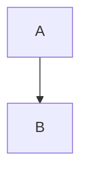

# Kitchen sink

Plain paragraph with **bold**, *italic*, _underscore italic_, ~~strike~~, `code`, and a [link](https://example.com).
A soft line
break inside the paragraph, and a hard one\
after a backslash.

## Lists

- one
- two
  - nested two a
  - nested two b
- three

1. first
2. second
   1. inner
3. third

5. starts at five
6. six

- [ ] open task
- [x] done task
  - [ ] nested task
- [ ] another

## Blocks

> A quotation
> over two lines.

> [!NOTE]
> A note with **bold**.

> [!WARNING] Titled
> Careful.

:::details Toggle title

Inside the toggle.

- a list inside

:::

---

```ts
const x: number = 1
function f() { return x }
```



```
plain fence
```

$$
\int_0^1 x\,dx
$$

Inline math $a^2 + b^2 = c^2$ and an escaped \$5 price.

| Left | Centre | Right |
| :--- | :---: | ---: |
| a | **b** | `c` |
| [l](https://x.y) | e | f |

https://example.com/standalone-link

See [[SU-12]], [[docs/some-page]] and [[@jose]].

![[query:space=ENG state=open]]

{align=center width=640}

Colours #ff0000 and #00ff00 in prose.

Characters that need escaping: 1\. not a list, \* not emphasis, \_ not either, <angle> & ampersand.

### Heading three

#### Heading four

Text with trailing spaces  
and a two-space break.

Emoji ✓ and unicode “quotes” – dash.

Final paragraph.
